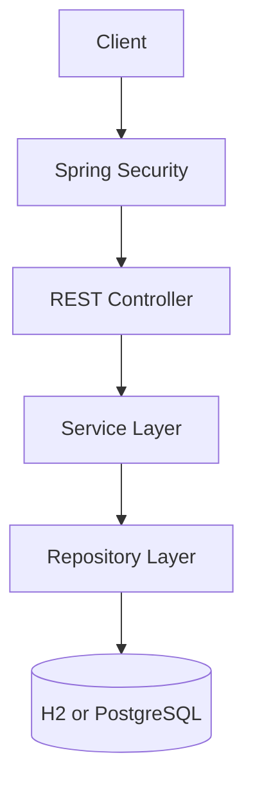
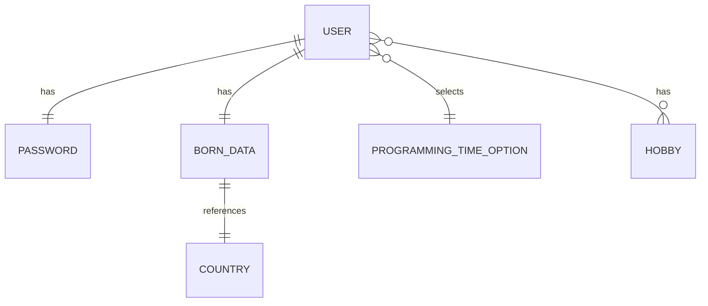

# Architecture

First of all, thank you for taking a look at this documentation :)

The Honey API Playground is a single Spring Boot application organized using a layered architecture.

## High-Level Structure

The main application components can also be represented as follows:



The application also uses DTOs, validation components, exception handlers, and cross-cutting concerns for token validation.

## Main Packages

### `controller`

Defines the REST endpoints and receives HTTP requests.

### `service`

Contains the main business rules and coordinates operations between controllers and repositories.

### `repository`

Provides persistence access through Spring Data JPA.

### `domain`

Contains the entities persisted in the database, such as users, hobbies, countries, and programming time options.

### `dto`

Contains request, response, and model objects used to control the data exchanged through the API.

### `validation`

Contains reusable validation logic for request fields and custom validation rules.

### `handler` and `exception`

Define the application's custom exceptions and translate them into HTTP responses.

### `aspect` and `annotation`

Contain the custom annotation and AspectJ logic used to validate the JWT token before protected user operations.

## Domain Model

The main domain relationships are structured as follows:



The same structure can be represented in a simpler hierarchical view:

```text
User
 ├── 1:1 Password
 ├── 1:1 BornData
 │       └── 1:1 Country
 ├── N:1 ProgrammingTimeOption
 └── N:N Hobby
```

The `User` entity is the central domain object. It is related to:

- One `Password` entity.
- One `BornData` entity.
- One `ProgrammingTimeOption` entity, which can be shared by multiple users.
- Multiple `Hobby` entities.

The `BornData` entity is also related to one `Country` entity. Countries, hobbies, and programming time options act as supporting reference data used during user registration and update operations.

## Application Style

The project is a monolithic application with separated internal layers. The current structure is intended to keep responsibilities organized while remaining simple enough for learning and experimentation.

[Back to README](../README.md)
